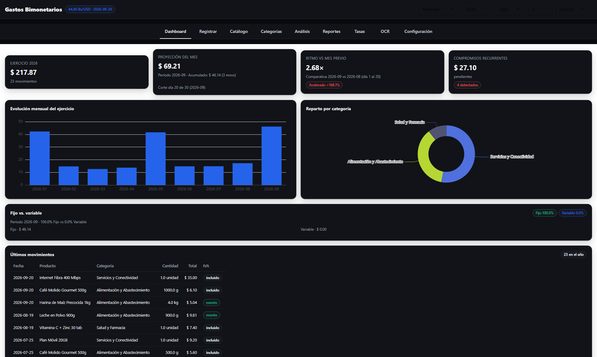
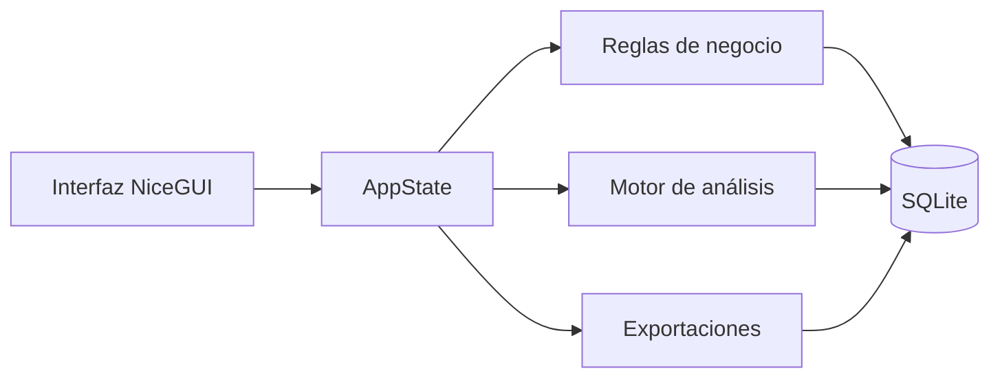

# Gastos Bimonetarios · Python Edition

**Auditoría contable bimonetaria (Bs/USD) para economías con inflación crónica.**

Una aplicación local que registra cada gasto en bolívares y en dólares con la tasa histórica del día, y lo convierte en información útil: precios unitarios, inflación ponderada, presupuesto, proyecciones y cierres auditables.


> **Código disponible para evaluación.** Este proyecto **no es open source**. La licencia es propietaria y todos los derechos están reservados. Consulta [Licencia](#licencia) antes de usar, copiar o distribuir el código.

---

## Índice

- [Qué es](#qué-es)
- [El problema que resuelve](#el-problema-que-resuelve)
- [Características](#características)
- [Stack técnico](#stack-técnico)
- [Instalación](#instalación)
- [Uso](#uso)
- [Arquitectura](#arquitectura)
- [Calidad y pruebas](#calidad-y-pruebas)
- [Privacidad y seguridad](#privacidad-y-seguridad)
- [Limitaciones conocidas](#limitaciones-conocidas)
- [Roadmap](#roadmap)
- [Licencia](#licencia)
- [Contacto](#contacto)

---

## Qué es

**Gastos Bimonetarios** nació como una aplicación personal para resolver un problema concreto: llevar una contabilidad rigurosa cuando la moneda en la que cobras y la moneda en la que piensas no son la misma.

Esta edición lleva ese modelo a **Python**, con una interfaz web local, una base de datos SQLite y un motor de análisis que no depende de hojas de cálculo.

No es un gestor de gastos genérico. Es una herramienta de **auditoría contable** que entiende que, en una economía bimonetaria, la inflación no es un detalle: es el problema.

**En una frase:** cada compra conserva su tasa, su base imponible, su IVA y sus dos importes; el análisis se construye sobre esos datos, no sobre una tasa recalculada al vuelo.



*Dashboard con el conjunto de demostración: 23 compras en el entorno Personal y tasa histórica por operación.*

---

## El problema que resuelve

En Venezuela —y en cualquier economía con inflación crónica— registrar un gasto obliga a responder preguntas que una app "normal" no responde:

| Pregunta | Cómo la responde Gastos Bimonetarios |
|---|---|
| ¿Cuánto costó de verdad ese producto? | Precio unitario normalizado por unidad de medida (g, kg, unidad, litro…) y por la tasa histórica aplicada. |
| ¿La inflación del café me está comiendo el sueldo? | Inflación personal ponderada (Laspeyres) y CAGR por producto. |
| ¿A qué comercio le estoy regalando dinero? | Pivote por proveedor, marca, método de pago, plataforma de fondeo y subcategoría. |
| ¿Voy a terminar el mes en números rojos? | Run-rate, burn-rate contra el mismo punto del mes anterior y punto de equilibrio. |
| ¿Este mes me pasé del presupuesto? | Semáforo automático por categoría contra el promedio histórico. |
| ¿Estoy comprando al precio óptimo? | Lupa de variantes: volumen, precio unitario e inversión en una sola vista. |
| ¿Cuánto IVA he pagado realmente? | Auditoría de IVA separando base imponible, cuota y peso sobre el gasto total. |
| ¿Cuál fue el año fiscal en una foto? | Acta de cierre imprimible con KPIs, principales categorías, devaluación e inflación media. |

Todo ocurre **en tu computadora**. Sin nube, sin cuentas, sin que tus finanzas viajen a un servidor de terceros.

---

## Características

### Núcleo contable

- **Doble entorno:** Personal y Profesional, con categorías, catálogo y transacciones independientes en la misma base de datos.
- **Doble moneda nativa:** cada transacción guarda `amountBs`, `amountUsd`, `rate`, `rateDate` y `rateSource`. Nunca se recalcula con la tasa del día.
- **IVA configurable y auditable:** modos **Exento**, **IVA incluido** e **IVA sobre el monto**, con tasa editable por compra (16 % por defecto), vista previa en vivo y detalle de base, cuota y alícuota en el histórico.
- **Catálogo SKU:** generación de códigos `PROD-P-XXXX` / `PROD-W-XXXX`, herencia de metadatos y propagación del nombre al renombrar un producto.
- **Categorías dinámicas:** cada categoría define qué campos aplican (cantidad, unidad, marca, IVA, naturaleza…) y permite campos personalizados de texto, número, lista y sí/no.
- **Editor de compras:** corrección y borrado con recálculo bidireccional Bs/USD, cambio de categoría, tasa de IVA editable, vista previa y validación.
- **Registro continuo:** la fecha, la categoría y la tasa de IVA se pueden conservar entre compras para no repetirlas; un aviso muestra cuándo la fecha quedó fijada y un botón vuelve al día de hoy.
- **Movimientos localizables:** buscador por producto/categoría/comercio/notas, filtro por categoría, vista en cascada por mes y lista con barra de desplazamiento y cabecera fija.
- **Autocompletado tolerante a erratas:** busca por nombre, SKU, categoría, marca o comercio; al elegir un producto recupera sus datos y los de su última compra. Si escribes una variante parecida, sugiere el valor existente y evita duplicados al guardar.
- **Tasa manual persistente:** se guarda en la configuración y sobrevive a la recarga; se libera al sincronizar con el BCV.
- **OCR de tickets:** flujo con RapidOCR (ONNX, sin binarios externos) o texto pegado, tabla editable e importación por lote.
- **Multi-tasa histórica:** sincronización opcional con el BCV a través de tres endpoints públicos y selección de la tasa histórica más cercana para cada fecha.

### Análisis

| Módulo | Qué resuelve |
|---|---|
| **Precios** | Historial por producto, comparador A/B, precio unitario en Bs o USD, CAGR, inflación ponderada y alerta de sobreprecio. |
| **Variantes** | Comparación por unidad, marca, subcategoría, comercio, forma de pago, plataforma, categoría o producto para identificar cuál sale más económica por unidad. |
| **Pivote** | Agrupación por comercio, marca, método de pago, plataforma de origen o subcategoría; mínimos, máximos, promedio, mediana y dispersión. |
| **Frecuencia** | Intervalo promedio entre compras, próxima fecha estimada, ticket promedio y hábitos de abastecimiento, con la misma lista de agrupaciones que Variantes. |
| **Proyecciones** | Regresión lineal sobre tasas BCV y precios de producto, con R² visible y horizonte configurable. |
| **Categorías** | Impacto por categoría, auditoría de IVA por compra (base, cuota y tasa aplicada), reparto por método de pago, semáforo de presupuesto, Pareto 80/20 y dispersión de importes. |
| **Extras** | Árbol jerárquico categoría → subcategoría → producto y tabla de productos con micro-análisis por SKU. |

### Reportes y cierre

- **Excel de 6 hojas:** resumen, libro mayor, catálogo, análisis, categorías/pagos y tasas.
- **Tres CSV:** movimientos, catálogo y tasas, con cabeceras que incluyen los campos personalizados.
- **Respaldo JSON completo:** exporta **todos** los entornos, no solo el activo. La importación valida el archivo y evita duplicados por firma.
- **Acta de cierre:** HTML imprimible con KPIs, top de categorías, devaluación e inflación media. Se guarda como PDF desde el diálogo de impresión del navegador.
- **Cierre anual:** guarda un snapshot del ejercicio y permite archivar el año.

### Interfaz

- **Nueve pestañas:** Dashboard, Registrar, Catálogo, Categorías, OCR, Análisis, Reportes, Tasas y Configuración.
- **Tema oscuro y claro**, tipografía tabular y componentes consistentes.
- **Gráficos ECharts** integrados en NiceGUI.
- **Datos de demostración:** 9 tasas, 8 SKU y 23 compras para explorar la aplicación sin cargar datos reales.
- **Sin paso de build:** el frontend se sirve desde el propio proceso Python.

---

## Stack técnico

| Capa | Tecnología | Nota |
|---|---|---|
| Lenguaje | Python 3.11+ | Probado en Python 3.13.15. |
| Interfaz | NiceGUI 3.18 / Quasar | Aplicación web local; no requiere compilación ni bundler. |
| Base de datos | SQLite 3 | WAL, claves foráneas e índices compuestos. |
| Análisis | Python puro | Sin pandas ni numpy: fórmulas explícitas y testeables. |
| Gráficos | Apache ECharts | Servido por NiceGUI. |
| Excel | openpyxl | Libro de 6 hojas. |
| OCR | RapidOCR (ONNX) | Opcional; también acepta texto pegado. |
| Tasas | httpx | Tres endpoints públicos; se usa el primero que responda. |
| Pruebas | pytest + doctests | 523 pruebas automatizadas. |

**Arquitectura de ejecución:** un único proceso NiceGUI con SQLite. No hay un backend separado, un frontend estático que compilar ni un servicio externo obligatorio.

---

## Instalación

### Requisitos

- **Python 3.11 o superior.**
- **Windows (probado), macOS y Linux.** La interfaz se abre en el navegador.
- **Conexión a internet solo si** quieres sincronizar la tasa del BCV o instalar dependencias.

### Windows

Desde la carpeta del proyecto:

```powershell
py -3 -m venv .venv
.venv\Scripts\python.exe -m pip install --upgrade pip
.venv\Scripts\python.exe -m pip install -r requirements.txt
.venv\Scripts\python.exe main.py
```

También puedes hacer **doble clic en `iniciar.bat`**: arranca el servidor y abre el navegador.

### macOS / Linux

Desde la carpeta del proyecto:

```bash
python3 -m venv .venv
source .venv/bin/activate
python -m pip install --upgrade pip
python -m pip install -r requirements.txt
python main.py
```

### OCR opcional

```bash
python -m pip install -r requirements-ocr.txt
```

Sin esta dependencia, la pestaña **OCR** sigue funcionando: puedes pegar el texto del ticket y el lote se importa igual.

### Primer arranque

La aplicación escucha en `http://127.0.0.1:8080`. La primera vez crea la base de datos en `data/gastos-bimonetarios.sqlite3` y siembra las categorías iniciales.

Para verla con datos: **Configuración → Cargar demo**.

---

## Uso

```bash
# Arranque normal
python main.py

# Cambiar puerto o base de datos
python main.py --port 8099 --db C:\datos\gastos.sqlite3

# Elegir el entorno inicial
python main.py --workspace profesional

# Desarrollo con recarga automática
python main.py --reload
```

La guía completa, escrita para uso diario y sin conocimientos técnicos, está en **[`MANUAL-DE-USO.md`](MANUAL-DE-USO.md)**.

---

## Arquitectura

```text
.
├─ main.py                  Punto de entrada
├─ iniciar.bat              Lanzador para Windows
├─ requirements.txt         Dependencias base
├─ requirements-ocr.txt     Dependencias del OCR
├─ MANUAL-DE-USO.md         Guía de uso
├─ LICENSE                  Licencia propietaria
│
├─ app/
│  ├─ core/                 Constantes, dinero, fechas, estadística
│  ├─ data/                 Esquema SQLite, repositorio y semilla
│  ├─ domain/               Transacciones, IVA, tasas, recurrentes, cierres
│  ├─ analytics/            Precios, inflación, pivote, frecuencia, proyecciones
│  ├─ exports/              Excel, CSV, respaldo JSON y acta
│  └─ ui/                   Estado, layout, componentes y nueve paneles
│
└─ tests/                   Pruebas unitarias, de integración y doctests
```

La regla de diseño es sencilla: **la interfaz solo pinta**. Cada panel delega en `app.domain`, `app.analytics` o `app.exports`; ninguna fórmula vive en la capa visual. Eso permite probar el motor sin navegador y mantener la interfaz reemplazable.



Cada pestaña del navegador crea su propio `AppState` (año fiscal, entorno, moneda, decimales, tema y tasa de sesión) sobre el mismo archivo SQLite. La conexión se cierra cuando la pestaña se elimina.

---

## Calidad y pruebas

```bash
# Suite completa: pruebas + doctests
python -m pytest

# Un módulo concreto
python -m pytest tests/test_domain.py -v
```

La suite cubre, entre otros:

- redondeo y formato con semántica de coma flotante;
- fechas, períodos y desbordes de calendario;
- IVA, transacciones, tasas y recurrencias;
- agregaciones, regresiones, CAGR, Laspeyres, Pareto y outliers;
- exportación a Excel, CSV, JSON y acta;
- persistencia SQLite y repositorio;
- flujos de interfaz con `nicegui.testing.user_simulation`.

**Estado actual:** 523 pruebas aprobadas.

---

## Privacidad y seguridad

- **Local-first:** la aplicación escucha en `127.0.0.1` por defecto. No hay cuentas, nube ni telemetría.
- **Sin secretos:** no hay claves API, tokens ni contraseñas en el código.
- **Sin llamadas externas** salvo la sincronización opcional de la tasa con `ve.dolarapi.com`, `pydolarve.org` y `api.exchangedyn.com` (BCV).
- **SQLite en WAL:** ante un corte de energía, la base vuelve a un estado consistente.
- **Respaldo JSON:** exporta todos los entornos y sirve para mover los datos a otra máquina.
- **Borrado con confirmación:** la acción de vaciar la base exige confirmarla en un diálogo. Exporta un respaldo antes.

> **Si expones el servidor fuera de `localhost`, añade autenticación y TLS.** La aplicación no trae autenticación remota porque está pensada para un único usuario en su equipo.

---

## Limitaciones conocidas

- **Un solo usuario local.** No hay autenticación, permisos ni sincronización entre dispositivos.
- **Migraciones mínimas y aditivas.** Al abrir una base antigua se añaden columnas nuevas con su valor por defecto (por ejemplo `ivaRate`); no se borran datos. Aun así, guarda un respaldo JSON y una copia del `.sqlite3` antes de actualizar.
- **El OCR es una ayuda, no una verdad absoluta.** La calidad depende de la foto; las filas se revisan antes de importar.
- **El acta se entrega en HTML.** El PDF se obtiene con la impresión del navegador, no con un generador PDF interno.
- **La interfaz es de escritorio.** Es responsive, pero no es una app móvil nativa.
- **Los endpoints de tasa pueden cambiar.** Si fallan, la tasa manual y el historial local siguen funcionando.
- **No hay integración bancaria.** Los datos se introducen a mano, por OCR o por importación de respaldo.

> **Aviso fiscal y legal.** La aplicación es una herramienta de registro y análisis, no un sistema certificado de facturación ni asesoría contable, fiscal o legal. La tasa de IVA es editable y se guarda con cada compra, pero la alícuota, exenciones y tratamientos aplicables dependen de la normativa vigente y de la situación de cada contribuyente. Verifica los importes con tu contador o con la autoridad fiscal antes de presentar declaraciones.

---

## Roadmap

Las siguientes ideas están en evaluación; no son compromisos de entrega:

- autenticación opcional y CORS configurable para despliegues controlados;
- sincronización cifrada entre dispositivos, opt-in;
- aplicación móvil reutilizando el motor de análisis;
- pronósticos con `statsmodels` (ARIMA/Prophet) por producto;
- motor de reglas y notificaciones;
- multi-usuario con permisos (contador vs. titular).

---

## Licencia

**Copyright © 2026 Angel Villegas. Todos los derechos reservados.**

Este repositorio se publica para **evaluación y consulta**. No se concede permiso para usar, copiar, modificar, fusionar, publicar, distribuir, sublicenciar ni explotar comercialmente el software, total o parcialmente, sin autorización previa y por escrito del titular.

Consulta el archivo **[`LICENSE`](LICENSE)** para los términos completos. Las dependencias de terceros conservan sus propias licencias; ver **[`THIRD-PARTY-NOTICES.md`](THIRD-PARTY-NOTICES.md)**.

Para una licencia comercial, una adaptación a tu empresa o soporte técnico, escribe a **angelgasv29@gmail.com**.

---

## Contacto

**Angel Villegas** · [angelgasv29@gmail.com](mailto:angelgasv29@gmail.com)

Si el proyecto te resulta útil, la mejor forma de apoyarlo es probarlo, reportar un problema con pasos reproducibles o compartirlo con alguien que lleve su contabilidad en bolívares y dólares.
